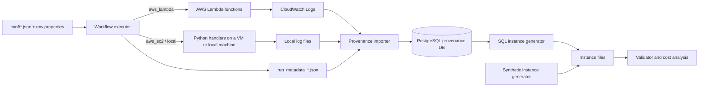
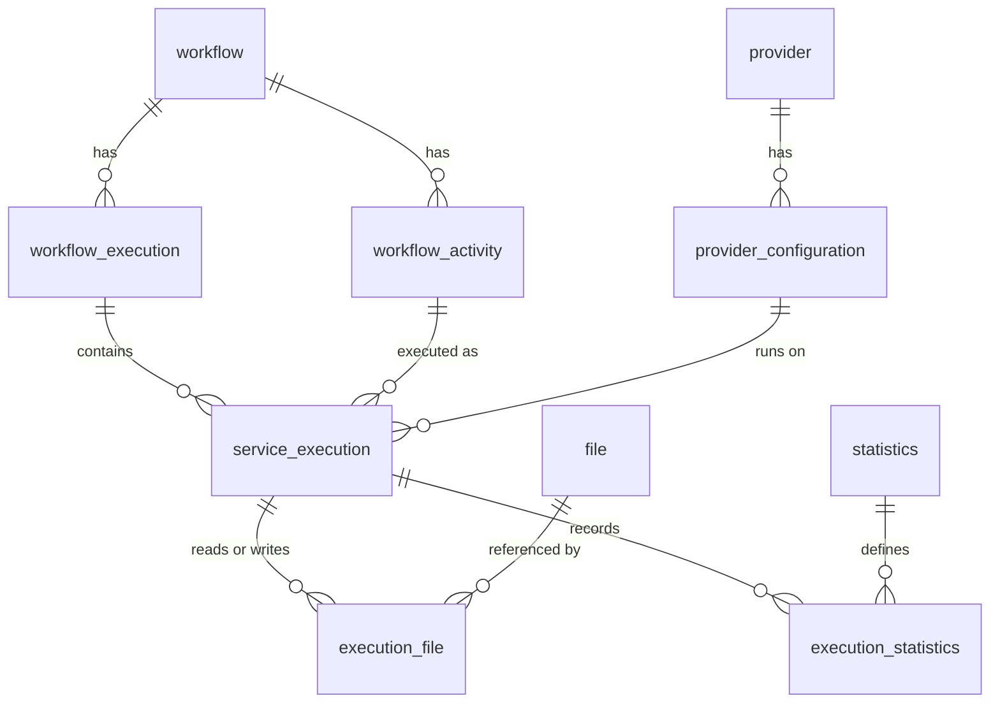

# Denethor

**Run scientific workflows on AWS Lambda, Amazon EC2 or your own machine, capture their provenance and performance data, and turn real executions into scheduling instances for hybrid VM–serverless research.**

[](LICENSE)


Denethor is developed by the [UFF eScience group](https://github.com/UFFeScience) at the Instituto de Computação, Universidade Federal Fluminense (Brazil).

---

## Table of contents

- [Overview](#overview)
- [Key features](#key-features)
- [The example workflow](#the-example-workflow)
- [Repository structure](#repository-structure)
- [Requirements](#requirements)
- [Installation](#installation)
- [Configuration](#configuration)
- [Quick start: run the workflow locally](#quick-start-run-the-workflow-locally)
- [Running on AWS Lambda](#running-on-aws-lambda)
- [Running on Amazon EC2](#running-on-amazon-ec2)
- [Capturing provenance](#capturing-provenance)
- [Generating scheduling instances](#generating-scheduling-instances)
- [The file_metrics utility](#the-file_metrics-utility)
- [Experiment data in this repository](#experiment-data-in-this-repository)
- [Further documentation](#further-documentation)
- [Known limitations](#known-limitations)
- [Citation](#citation)
- [License](#license)

---

## Overview

Choosing where each task of a scientific workflow should run (a serverless function with a given memory size, or a virtual machine) requires real measurements of time and cost. Denethor covers that whole cycle:

1. **Execute** each activity of a workflow on a chosen provider: an AWS Lambda function configuration (128 MB to 2048 MB), an EC2 virtual machine, or the local machine. The same handler code runs on all three.
2. **Record** what happened during every invocation: duration, billed duration, cold-start time, memory used, and every file read or written, with its size and transfer time.
3. **Import** those records into a relational provenance database (PostgreSQL).
4. **Generate instance files** from the database: the workflow DAG, a time × cost matrix per configuration, VM characteristics and storage pricing. Scheduling models and heuristics read these files directly. Synthetic instances can be generated and validated in the same format.



The repository deliberately keeps four related parts together, because each one feeds the next (see [docs/repository_domains.md](docs/repository_domains.md)):

| Part | Purpose | Main paths |
| --- | --- | --- |
| Denethor core | Workflow execution, provenance capture, real instance generation | `src/denethor/`, `src/run_workflow_*.py`, `scripts/sql/instance_generator/` |
| Example workflow | A phylogenetic analysis used as workload and metric source | `src/lambda/`, `conf/workflow_steps.json` |
| file_metrics | Measures S3 upload/download times | `src/file_metrics/` |
| Instance modeling | Synthetic instance generation, parsing, validation, cost analysis | `src/instance_modeling/` |

## Key features

- **One handler, three providers.** Activities are plain Python modules with a `handler(event, context)` function. They are deployed as Lambda functions, or imported and called directly on a VM or locally.
- **Two execution strategies.** `for_each_input` invokes the activity once per input item (parallel fan-out); `for_all_inputs` invokes it once for the whole set (aggregation).
- **Parameter sweeps.** A single run executes the workflow for several input sizes and several Lambda memory configurations, and records every execution in a `run_metadata_<timestamp>.json` file.
- **Log-based provenance.** Activities write structured log records. The keys to extract are declared in `conf/statistics.json`, so you can capture a new metric by logging it and declaring it, without changing the importer.
- **Relational provenance model** with views for analysis and a procedure to delete a single execution.
- **Instance generation** from real executions (SQL-based) and from synthetic definitions, plus a validator.
- **Deployment scripts** for the IAM role, Lambda layers and functions (one per memory configuration) and EC2 instances.

## The example workflow

The bundled workflow builds phylogenetic trees from protein sequences and mines them for shared subtrees. It has four activities, chained through named runtime parameters (`input_files → tree_files → subtree_files → intermediate_mafdb_files → final_mafdb_file`):

| # | Activity | What it does | Strategy |
| --- | --- | --- | --- |
| 1 | `tree_constructor` | Validates the FASTA sequences (removing duplicates when needed), aligns them with ClustalW and builds a Neighbor-Joining tree from an identity distance matrix (Biopython). | `for_each_input` |
| 2 | `subtree_constructor` | Extracts every subtree with more than one leaf from each tree. | `for_each_input` |
| 3 | `maf_database_creator` | Compares subtrees from different trees, counting shared leaves, and writes a partial MAF database (subtree pair frequency matrix). | `for_each_input` |
| 4 | `maf_database_aggregator` | Merges the partial MAF databases into the final one and reports the maximum MAF value. | `for_all_inputs` |

**Input data:** `resources/data/full_dataset/` holds 201 FASTA files of protein sequences named after OrthoMCL ortholog groups (`ORTHOMCL1`, `ORTHOMCL256`, …), about 1.2 MB in total. Trees are written in Nexus format by default (Newick is also supported through `data_format` in `conf/env.properties`).

## Repository structure

```text
denethor/
├── conf/                        # Workflow, provider, statistics and environment configuration
├── docs/                        # Detailed guides (AWS setup, Lambda, instance file format, …)
├── resources/
│   ├── data/
│   │   ├── full_dataset/        # 201 protein FASTA files (workflow input)
│   │   └── instance_files/      # Real and synthetic scheduling instances
│   ├── libs/                    # ClustalW 2.1 binaries (Linux x86-64 and Windows)
│   └── logs/                    # Execution logs and run metadata (aws_lambda, aws_ec2, local)
├── scripts/
│   ├── aws/                     # Environment loading, IAM, Lambda layers/functions, EC2 management
│   └── sql/                     # Schema, views, procedures, instance-generation and analysis queries
├── src/
│   ├── denethor/                # Core library
│   │   ├── core/                # Data model, repositories, services, DB connection, logger
│   │   ├── executor/            # Workflow executor, execution manager, Lambda/local/EC2 invokers
│   │   ├── provenance/          # Log retrieval, parsing and provenance import
│   │   ├── monitor/             # Execution monitoring
│   │   └── utils/               # AWS, file and general helpers
│   ├── lambda/                  # Activity handlers of the example workflow (+ JSON test events)
│   ├── instance_modeling/       # Instance generation (real and synthetic), parser, validator, cost analysis
│   ├── file_metrics/            # S3 transfer-time measurement utility
│   ├── run_workflow_on_aws_lambda.py
│   ├── run_workflow_on_aws_ec2_or_local.py
│   └── import_provenace_using_metadata_file.py
├── tests/                       # Unit tests and exploratory scripts
├── requirements.txt             # Dependencies for the orchestrating machine
└── requirements_aws.txt         # Minimal set packaged into the Lambda base layer
```

> **Repository size:** the working tree is about 3.7 GB, almost all of it execution logs under `resources/logs/`. Clone with `--depth 1` to skip the history.

## Requirements

- **Operating system:** Linux. The scripts were written on Ubuntu 22.04; EC2 instances use Amazon Linux. A ClustalW binary for Windows is also included.
- **Python 3.10 or 3.11.** The Lambda functions use the `python3.10` runtime, and the pinned Biopython 1.81 targets these versions.
- **ClustalW 2.1:** bundled in `resources/libs/`.
- **Python packages:** Biopython 1.81, DendroPy 4.6.1, boto3, SQLAlchemy, psycopg2, paramiko, python-dotenv.
- **For cloud runs:** an AWS account and the AWS CLI v2, with access to S3, Lambda, CloudWatch Logs and IAM (EC2 optional).
- **For provenance:** a PostgreSQL server.

## Installation

```bash
git clone --depth 1 https://github.com/UFFeScience/denethor.git
cd denethor

python3.11 -m venv .venv
source .venv/bin/activate

pip install -r requirements.txt python-dotenv
chmod +x resources/libs/clustalw-2.1-linux/clustalw2
```

Notes:

- `python-dotenv` is used by the database connection (`src/denethor/core/database/conn.py`) but is not listed in `requirements.txt`, so it is installed explicitly above.
- `psycopg2` is compiled from source. If the install fails, either install the PostgreSQL headers (`sudo apt-get install libpq-dev python3-dev`) or install `psycopg2-binary` instead.

## Configuration

### Files in `conf/`

| File | Purpose |
| --- | --- |
| `env.properties` | INI-style settings. `[denethor]`: log directory and file-name patterns. `[bucket]`: S3 bucket name and the key (folder) of each activity's data. `[aws_lambda]`, `[aws_ec2]`, `[local]`: data format, working directories, ClustalW path and log output type for each provider. |
| `workflow_steps.json` | The ordered list of activities to execute (see below). |
| `workflow.json` | Workflow name, description and activities, as stored in the provenance database. |
| `provider.json` | Providers and their configurations (memory, timeout, CPU, storage). |
| `statistics.json` | Which log records and keys become provenance statistics. |
| `workflow_steps_ec2.json` | An older EC2-oriented variant of the steps file; the current run scripts do not load it. |

### Workflow steps

Each entry of `conf/workflow_steps.json` describes one activity:

| Field | Meaning |
| --- | --- |
| `activity` | Name of the handler module in `src/lambda/` and base name of the Lambda function. |
| `provider` | `aws_lambda`, `aws_ec2` or `local`. |
| `memory` | Lambda memory in MB. The executor invokes the function `<activity>_<memory>`, e.g. `tree_constructor_128`. |
| `strategy` | `for_each_input` or `for_all_inputs`. |
| `data_params.input_files_path` / `input_files_list` | First step only: where the input files are and which ones to use. |
| `data_params.param_in` / `param_out` | Runtime keys consumed and produced. The `param_out` of one step is the `param_in` of the next. |
| `active` | Set to `false` to skip the step. |

The run scripts overwrite `provider`, `memory` and `input_files_list` at runtime with the values of each sweep.

### Environment variables (`.env`)

The shell scripts and the database connection read a `.env` file in the repository root. It is already listed in `.gitignore`; never commit it. A template:

```bash
# Paths and runtime
DENETHOR_PATH=/path/to/denethor
PYTHON_VERSION=3.10
PYTHON_RUNTIME=python3.10
SLEEP_DURATION=5

# AWS account and region
AWS_ACCOUNT_ID=123456789012
AWS_ACCESS_KEY_ID=your-access-key-id
AWS_SECRET_ACCESS_KEY=your-secret-access-key
AWS_REGION=sa-east-1

# Lambda (bash arrays, read by the deployment scripts)
LAMBDA_FUNCTION_NAMES=(tree_constructor subtree_constructor maf_database_creator maf_database_aggregator)
LAMBDA_DEFAULT_TIMEOUTS=(30 30 30 30)
LAMBDA_DEFAULT_MEMORY=(128 128 128 128)
LAMBDA_MEMORY_SIZES=(128 256 512 1024 2048)
BASE_LAYER_NAME=base_layer
DENETHOR_LAYER_NAME=denethor_layer
LAMBDA_S3_ACCESS_ROLE=Lambda_S3_access_role

# S3
DENETHOR_S3_BUCKET=your-denethor-bucket
DENETHOR_S3_FULL_DATASET=data/full_dataset

# PostgreSQL provenance database
DENETHOR_DB_HOST=localhost
DENETHOR_DB_PORT=5432
DENETHOR_DB_DATABASE=denethor
DENETHOR_DB_USER=postgres
DENETHOR_DB_PASSWORD=your-password

# EC2
KEY_NAME=denethor-key
KEY_PATH=/path/to/denethor-key.pem
EC2_INSTANCE_ID=i-0123456789abcdef0
EC2_INSTANCE_NAME=denethor-vm
EC2_INSTANCE_TYPE=t2.micro
EC2_PATH=/home/ec2-user/denethor
EC2_USER=ec2-user
VPC_ID=vpc-0123456789abcdef0
SG_ID=sg-0123456789abcdef0
SG_NAME=denethor-sg
SG_DESCRIPTION="Denethor security group"
AMI_ID=ami-0123456789abcdef0
AMI_NAME=denethor-ami
AMI_DESCRIPTION="Denethor AMI"
```

`scripts/aws/load_env_vars.sh` checks that all of these are set before any AWS script runs.

> **Before using the shell scripts**, point them at your clone: set `env_file` in `scripts/aws/load_env_vars.sh` and `DENETHOR_DIR` in `scripts/aws/lambda/deploy_layer.sh` (both currently hold absolute paths from the original development machine).

## Quick start: run the workflow locally

No AWS account or database is needed for a local run.

1. Install the project as described in [Installation](#installation).
2. In `src/run_workflow_on_aws_ec2_or_local.py`, set the provider at the top of `main()`:

   ```python
   PROVIDER = const.LOCAL
   ```

3. From the repository root, run:

   ```bash
   python src/run_workflow_on_aws_ec2_or_local.py
   ```

   By default the script replays the input selection recorded in `resources/logs/aws_lambda/run_metadata_2025-06-06T16_28_00UTC.json` (a 4-file run). Pass another metadata file name to replay a different run:

   ```bash
   python src/run_workflow_on_aws_ec2_or_local.py run_metadata_<timestamp>.json
   ```

   To choose input files yourself, set `METADATA_DIR = None` and fill in the dictionary under *OPÇÃO 2.2* (manual file selection) in the same script:

   ```python
   workflow_input_files_by_count = {
       "2": ["ORTHOMCL371", "ORTHOMCL1313"],
   }
   ```

**Outputs:**

| Location | Content |
| --- | --- |
| `.tmp/tree`, `.tmp/subtree`, `.tmp/mafdb` | Trees, subtrees and MAF databases |
| `resources/logs/local/log_wetag_<ms>_<activity>.log` | Structured log of each activity |
| `resources/logs/local/run_metadata_<timestamp>.json` | Parameters, runtime data and errors of every execution in the run |

Each workflow execution gets an execution tag `wetag_<start-time-in-ms>`, which links its logs, metadata and provenance records.

## Running on AWS Lambda

### 1. Configure the AWS CLI

```bash
aws configure          # the project uses sa-east-1 by default
aws sts get-caller-identity
```

See [docs/1_aws_setup.md](docs/1_aws_setup.md) for installing the CLI and checking your account.

### 2. Create the bucket and upload the input data

S3 bucket names are global, so choose your own and set it in `conf/env.properties` (`[bucket] name=`) and in `.env` (`DENETHOR_S3_BUCKET`).

```bash
aws s3api create-bucket --bucket your-denethor-bucket --region sa-east-1 \
    --create-bucket-configuration LocationConstraint=sa-east-1
aws s3 cp resources/data/full_dataset s3://your-denethor-bucket/data/full_dataset --recursive
```

### 3. Create the IAM role

```bash
cd scripts/aws/lambda/iam
./create_lambda_s3_role.sh
```

This creates the role named in `LAMBDA_S3_ACCESS_ROLE` and attaches `AmazonS3FullAccess`, `AWSLambdaBasicExecutionRole` and `AWSLambdaExecute`.

### 4. Publish the Lambda layers

```bash
cd scripts/aws/lambda
./deploy_layer.sh      # choose 1) base_layer
./deploy_layer.sh      # choose 2) denethor_layer
```

- `base_layer` holds the packages in `requirements_aws.txt` and the ClustalW Linux binary, which Lambda mounts at `/opt/python/clustalw-2.1-linux` (the path set in `env.properties`).
- `denethor_layer` holds the `src/denethor` library.

### 5. Deploy the functions

The executor invokes one function per activity **and** memory size (`tree_constructor_128`, `tree_constructor_256`, …), so deploy every configuration you plan to sweep:

```bash
cd scripts/aws/lambda

# Interactive; answer "all" to deploy the chosen function for every size in LAMBDA_MEMORY_SIZES
./deploy_lambda_function_menu.sh

# Or one configuration at a time (-a true appends the memory size to the function name)
./deploy_lambda_function.sh -f tree_constructor -r sa-east-1 -t 30 -m 128 -a true
```

The scripts always use the latest version of both layers. If the function already exists, its code and configuration are updated. Timeouts must be between 30 and 300 seconds.

### 6. Run the workflow

Set the sweep at the top of `main()` in `src/run_workflow_on_aws_lambda.py`:

```python
PROVIDER = const.AWS_LAMBDA
MEMORY_LIST = [128, 256, 512, 1024, 2048]   # one Lambda configuration per value
FILE_COUNT_LIST = [2, 5, 10]                # number of input files per execution
FILE_SELECTION_MODE = "first"               # "first" or "random"
ACTIVE_STEPS = None                         # or a list of activity names to run
```

Then, from the repository root:

```bash
python src/run_workflow_on_aws_lambda.py
```

Every combination of file count and memory size is one workflow execution. Functions are invoked synchronously, and the run is recorded in `resources/logs/aws_lambda/run_metadata_<timestamp>.json`, the input for the provenance import.

> This script loads the provenance services at start-up, so the PostgreSQL database in `.env` must be reachable before you run it (see [Capturing provenance](#capturing-provenance)).

## Running on Amazon EC2

On EC2, the activities run as plain Python modules on the instance, reading inputs from its disk. The usual pattern is to replay the input sets of a Lambda run, so that both providers are measured on the same data.

```bash
cd scripts/aws/ec2
./manage_instances.sh create            # also: list | start | stop | terminate [instance-id]
./copy_denethor_to_instance.sh src      # conf/, src/, requirements_aws.txt
./copy_denethor_to_instance.sh data     # resources/data/full_dataset/
./copy_denethor_to_instance.sh libs     # ClustalW Linux binary
./connect_to_instance.sh
```

On the instance (Python 3.10 or later), install the dependencies and replay a Lambda run:

```bash
pip install -r requirements_aws.txt
python3 src/run_workflow_on_aws_ec2_or_local.py run_metadata_<timestamp>.json
```

The metadata file must be present under `resources/logs/aws_lambda/` on the instance. Logs are written to `resources/logs/aws_ec2/`. Back on your machine, fetch them with:

```bash
./retrieve_log_file_from_instance.sh <search_term> [instance_id]
```

## Capturing provenance

### How it works

Every activity writes tab-separated log records whose first word is the record type:

```text
START RequestId: uuid_764d…	 Activity: tree_constructor	 Provider: local
FILE_TRANSFER RequestId: uuid_764d…	 TransferType: consumed	 FileName: ORTHOMCL1	 Bucket: denethor	 FilePath: data/full_dataset	 …
CONSUMED_FILES_INFO RequestId: uuid_764d…	 FilesCount: 1 files	 FilesSize: 1640 bytes	 TransferDuration: 0 ms	 …
TREE_CONSTRUCTOR RequestId: uuid_764d…	 Duration: 11.78 ms	 InputFile:ORTHOMCL1	 OutputFile:['tree_ORTHOMCL1.nexus']
PRODUCED_FILES_INFO RequestId: uuid_764d…	 FilesCount: 1 files	 FilesSize: 339 bytes	 …
END RequestId: uuid_764d…	 Activity: tree_constructor	 Provider: local
REPORT RequestId: uuid_764d…	 Duration: 124.46 ms	 Billed Duration: 124 ms	 …
```

`conf/statistics.json` maps each record type and key to a database field and data type. `default_statistics` covers the records shared by all activities (`START`, `END`, `REPORT`, `FILE_TRANSFER`, `CONSUMED_FILES_INFO`, `PRODUCED_FILES_INFO`); `custom_statistics` covers activity-specific records such as `TREE_CONSTRUCTOR` or `MAF_DATABASE_AGGREGATOR`. To capture a new metric, log it from the handler and declare it there.

For Lambda, the importer reads the CloudWatch log group `/aws/lambda/<activity>_<memory>`, restricted to the execution's time window. For EC2, it reads the log files already retrieved from the instance.

### 1. Create the database

```bash
createdb denethor
psql -d denethor -f scripts/sql/db_maintenance/database_creation.sql
psql -d denethor -f scripts/sql/db_maintenance/database_views.sql
psql -d denethor -f scripts/sql/db_maintenance/database_procs.sql
```

Then set the `DENETHOR_DB_*` variables in `.env`.

### 2. Import a run

```bash
python src/import_provenace_using_metadata_file.py run_metadata_<timestamp>.json
```

The `METADATA_DIR` constant in the script says where the metadata file is read from: `resources/logs/aws_ec2` by default, `resources/logs/aws_lambda` for Lambda runs. For each execution in the file, the importer registers the provider, workflow, activities and statistics (if new), creates the workflow execution, and then, for every active step, retrieves and parses the logs and stores service executions, files, transfers and statistics.

### Data model



| Table | Content |
| --- | --- |
| `provider`, `provider_configuration` | Execution environments and their configurations (memory, timeout, CPU, storage) |
| `workflow`, `workflow_activity` | Workflow definition |
| `workflow_execution` | One row per execution tag: start/end time, duration, input list, runtime data |
| `service_execution` | One row per invocation: request ID, duration, billed and init duration, memory, consumed/produced file counts, sizes and transfer times |
| `file`, `execution_file` | Files and each consumed or produced transfer |
| `statistics`, `execution_statistics` | Custom statistics and their values |
| `task` | Distinct tasks (activity + inputs + outputs) used for instance generation |
| `vm_configurations`, `bucket_ranges` | VM types (slowdown, cost, storage, bandwidth) and S3 pricing tiers |

Useful extras: the views `vw_service_execution_detail`, `vw_service_execution_files_agg`, `vw_task`, `vw_service_execution_task` and `vw_file_type`; the procedure `CALL delete_execution_data('wetag_…')`, which deletes one execution's data; and the analysis queries in `scripts/sql/paper_queries.sql` and `scripts/sql/handy_queries.sql`.

## Generating scheduling instances

An instance file describes a workflow scheduling problem in six tab-separated sections:

| Section | Content |
| --- | --- |
| Header | Number of tasks, configurations, data items, VMs, buckets and price tiers; maximum running time and financial cost |
| Tasks | DAG nodes: activity, type (VM or function), VM CPU time, input and output data IDs |
| Data | Size, average read/write times, static or produced |
| VM info | CPU slowdown, cost per second, storage, bandwidth |
| Time × cost matrix | Per task and function configuration: cost, total, init, CPU, read and write times |
| Bucket ranges | Storage price tiers |

Times are in seconds, sizes in bytes and costs in USD. The full specification is in [docs/instance_file_format.md](docs/instance_file_format.md) (in Portuguese).

### From real executions

1. Find the IDs of the workflow executions to combine (`we_id` in `workflow_execution`), e.g. with `scripts/sql/select_weids_for_instance_generator.sql`.
2. Set `INPUT_WEIDS_FX` (Lambda executions) and `INPUT_WEIDS_VM` (EC2 executions) in `src/instance_modeling/generate_instance_file_from_weid.py`.
3. From the repository root, run:

   ```bash
   PYTHONPATH=src python src/instance_modeling/generate_instance_file_from_weid.py
   ```

Executions are grouped by number of inputs, and each group's Lambda and EC2 executions become one instance. The queries in `scripts/sql/instance_generator/` (`01_totals.sql` to `06_bucket_ranges.sql`) build the sections. Output goes to `resources/data/instance_files/`, named `I<id>_T<tasks>_C<configs>_D<data>_VM<vms>__fx_weids[…]__vm_weids[…].txt`, together with a `sql_*.sql` file holding the exact queries used.

### Synthetic instances

```bash
# User-defined DAGs, from resources/data/instance_files/synthetic/synthetic_user_defined/synthetic_instances_definition.txt
python src/instance_modeling/synthetic/generate_synthetic_instances.py --mode user --workflows Synthetic_011 Synthetic_030

# Random DAGs (size parameters are constants at the top of the script)
python src/instance_modeling/synthetic/generate_synthetic_instances.py --mode random
```

The available synthetic instances and their DAGs are described in [docs/synthetic_instances.md](docs/synthetic_instances.md) (in Portuguese).

### Validation and cost analysis

```bash
# Validate one file or a whole directory
python src/instance_modeling/validate_instance_file.py resources/data/instance_files/synthetic/synthetic_user_defined

# Custom tolerance for the time-matrix sums, plus a JSON report
python src/instance_modeling/validate_instance_file.py path/to/instance.txt \
    --sum-tolerance-percent 0.10 --output-json report.json
```

The validator checks header counts against section rows, ID references across sections, and whether each configuration's total time matches init + CPU + read + write within the tolerance. It exits with `0` (valid), `1` (no files found) or `2` (inconsistencies found).

`src/instance_modeling/instance_cost_analysis.py` prints the cheapest all-function and all-VM assignment for each task of the instances listed in its `main()`. `src/instance_modeling/instance_io.py` provides the parser (`InstanceParser` → `ParsedInstance`) for use in your own code.

## The file_metrics utility

`src/file_metrics/` measures how long it takes to download and upload files of different sizes between S3 and Lambda (`lambda/`) or EC2 (`ec2/`), with its own schema and queries in `database/`. `generate_test_files.py` creates test files from 500 KB to 50 MB in `resources/data/test_download_files/`.

## Experiment data in this repository

The repository includes the raw data of the experiments run with Denethor, so the analyses can be reproduced without new cloud runs:

- `resources/logs/aws_lambda/` and `resources/logs/aws_ec2/`: logs and run metadata of the Lambda and EC2 campaigns (`run_1` to `run_4`: 2 to 50 input files with first-n or random selection, and 60 to 100 input files).
- `resources/data/instance_files/`: instance sets generated from those runs, plus the synthetic instances.
- `scripts/sql/db_maintenance/migration/backup_29-06-2025/`: a PostgreSQL dump and CSV export of the provenance database.

## Further documentation

| Document | Content |
| --- | --- |
| [docs/1_aws_setup.md](docs/1_aws_setup.md) | Installing the AWS CLI and checking your account |
| [docs/2_aws_bucket.md](docs/2_aws_bucket.md) | Creating the S3 bucket and uploading the dataset |
| [docs/3_aws_lambda.md](docs/3_aws_lambda.md) | Creating the IAM role, layers and functions by hand |
| [docs/denethor.md](docs/denethor.md) | Executor and configuration files (describes an earlier version of the workflow) |
| [docs/instance_file_format.md](docs/instance_file_format.md) | Instance file format, field by field (Portuguese) |
| [docs/synthetic_instances.md](docs/synthetic_instances.md) | Catalogue of synthetic instances (Portuguese) |
| [docs/repository_domains.md](docs/repository_domains.md) | The four parts of the repository and how they relate |

## Known limitations

- Execution parameters (provider, memory sizes, file counts, metadata file, execution IDs) are set as constants in the scripts rather than passed on the command line.
- Several shell scripts contain absolute paths from the original development machine; see the note in [Environment variables](#environment-variables-env).
- The EC2 provider runs the handlers on the machine where the script is started; there is no remote invocation from a separate orchestrator yet.
- Provenance import supports the `aws_lambda` and `aws_ec2` providers; local runs produce logs and metadata but are not imported.
- The `tests/` folder holds unit tests and exploratory scripts from development; they are not yet wired into a test runner or CI.

## Citation

A paper describing Denethor is in preparation. Until it is published, please cite this repository:

```bibtex
@misc{denethor,
  author       = {Ribeiro, Marcello W. M. and de Paula, Ubiratam and Kunstmann, Liliane and
                  Frota, Yuri and Rosseti, Isabel and de Oliveira, Daniel},
  title        = {Denethor: Execution, Provenance Capture and Instance Generation for
                  Scientific Workflows on Serverless and Virtual Machine Environments},
  year         = {2026},
  howpublished = {\url{https://github.com/UFFeScience/denethor}},
  note         = {UFF eScience Group, Instituto de Computa{\c{c}}{\~a}o, Universidade Federal Fluminense}
}
```

## License

Denethor is released under the [GNU General Public License v3.0](LICENSE).

Questions and bug reports are welcome in the [issue tracker](https://github.com/UFFeScience/denethor/issues).
